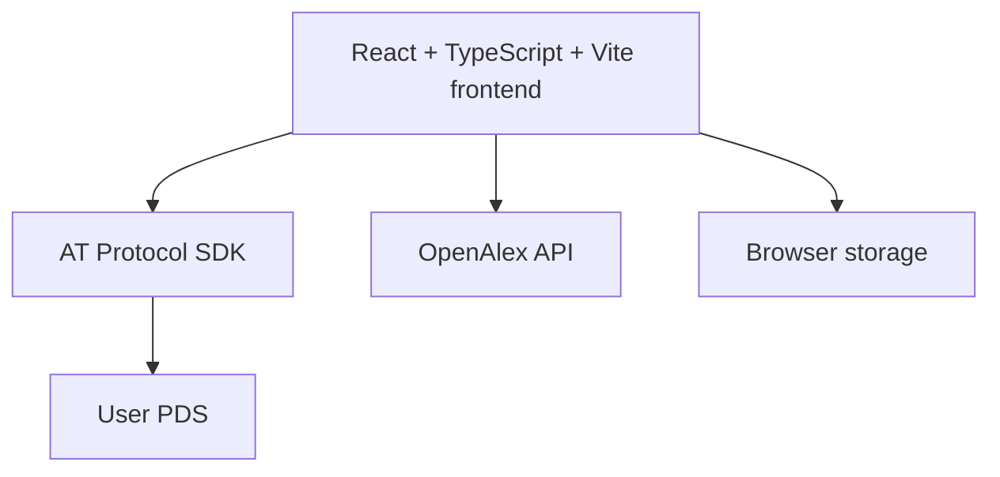

# PaperTrail

**A research paper discovery and organization web application.**

PaperTrail is a course project developed for UCSD CSE 210: Principles of Software Engineering. It aims to help users discover, save, and organize research papers while exploring AT Protocol for user authentication and user-owned data.

## Run locally

Use Node.js 22.22.2+ on the 22.x line, 24.15+ on the 24.x line, or 26+ (the component test environment requires these versions). From the repository root:

```sh
npm ci
npm run dev -- --host 127.0.0.1
```

Open the `http://127.0.0.1` URL printed by Vite. On Home, enter your AT Protocol handle to begin sign-in. To preview a production build locally, run `npm run build` followed by `npm run preview -- --host 127.0.0.1`. See [Authentication](docs/authentication.md) for OAuth deployment setup.

Paper discovery uses [OpenAlex](https://help.openalex.org/api/), which supports keyless API requests. For more reliable local testing, you can optionally add `VITE_OPENALEX_API_KEY=your_api_key` to a repository-root `.env.local` file and restart Vite.

> [!WARNING]
> Do not commit API keys or use a personal `VITE_` key in a public deployment: Vite exposes these variables to the browser. See [OpenAlex API Integration](docs/openalex.md) for search behavior and data mapping.

## Start a feature

The first demo follows sign-in → search → details → bookmark → saved papers. Sign-in is on Home. Browse/Search shows OpenAlex paper cards with pagination, and details loads metadata from its route ID. Bookmarks and saved papers remain integration work.

| Route | Page entry | Team issue |
| --- | --- | --- |
| `/` | `src/features/auth/HomePage.tsx` | [AT Protocol login #4](https://github.com/Caffeinated-Coders-CSE-210/PaperTrail/issues/4) |
| `/search` | `src/features/discovery/SearchPage.tsx` | [OpenAlex discovery #12](https://github.com/Caffeinated-Coders-CSE-210/PaperTrail/issues/12) |
| `/papers/:paperId` | `src/features/discovery/DetailsPage.tsx` | #12, with the bookmark control from #8 |
| `/saved` | `src/features/bookmarks/SavedPage.tsx` | [Bookmarks and library #8](https://github.com/Caffeinated-Coders-CSE-210/PaperTrail/issues/8) |

To check routing, open **Search**, select a paper card, and refresh. Its metadata reloads from OpenAlex. **Saved papers** and **Home** remain reachable from the header. The deployment owner should configure the host to serve `index.html` for direct page requests.

Run `npm test` for the Node service tests and Vitest component tests, then
`npm run build` for typechecking and a production build. Tests live beside their
features. See [Browse development](docs/browse-development.md) for the incremental
test record and integration notes for issue #2.

See [AGENTS.md](AGENTS.md) for service contracts, component conventions, and shared-file ownership.

## Project Goals

- Make research papers easier to discover, save, and discuss.
- Support useful interactions between readers, such as sharing notes and asking questions.
- Explore AT Protocol as a foundation for identity and user-owned structured records.
- Deliver a focused, tested MVP within the course's short development window.

## Software Engineering Goals

As part of CSE 210, we also aim to follow good software engineering practices throughout the project:

- Documentation: Maintain clear project documentation, including setup instructions, architecture, and contribution guidelines.

- Collaboration: Use GitHub issues, pull requests, and code reviews to coordinate development.

- Testing: Test core functionality and check for regressions as the project evolves.

- Maintainability: Keep the code organized and modular to make it easier to understand and extend.

## Why AT Protocol?

The architecture plan uses **AT Protocol OAuth** for login. Users can sign in with an existing AT Protocol identity, including a Bluesky account.

PaperTrail also plans to use users' **Personal Data Servers (PDSs)** to store public paper-related records. Custom **Lexicons** will define the record types used by the app. This lets us use AT Protocol for data storage as well as login.

## Planned Features

The current plans include:

- **AT Protocol login:** Sign in and out using an AT Protocol account.
- **Paper discovery:** Search for research papers and view paper information. The architecture plan uses OpenAlex for academic metadata.
- **Saved papers:** Bookmark papers and return to a personal saved-paper list.

## Proposed Tech Stack

| Technology | Purpose |
| --- | --- |
| React | Frontend UI and reusable components |
| TypeScript | Reduce integration errors across modules |
| Vite | Keep the frontend setup simple |
| AT Protocol SDK | OAuth and communication with user repositories |
| OpenAlex | Academic paper search and metadata |
| Vercel | Frontend hosting and deployment |

For the initial MVP, the proposed design does **not** include a separate backend server or SQL database. The frontend would communicate with AT Protocol services and OpenAlex, with browser storage for information that users do not want to publish.



More details are in [Architecture](docs/architecture.md) and [Architecture Decisions](docs/decisions.md).

## Documentation

- [Contributing Guidelines](docs/CONTRIBUTING.md): guidelines for issues, branching, commit messages, pull requests, and code reviews.
- [PR template](.github/pull_request_template.md): a template to keep pull requests consistent and easy to review.
- [Architecture](docs/architecture.md): an overview of the proposed system architecture and tech stack.
- [Decisions](docs/decisions.md): proposed technical decisions and the reasoning behind them.
- [Authentication](docs/authentication.md): AT Protocol OAuth sign-in, local development, HTTPS deployment, and auth state integration.
- [OpenAlex API Integration](docs/openalex.md): paper search, data mapping, and API configuration.

## License

This project uses the [MIT License](LICENSE).
