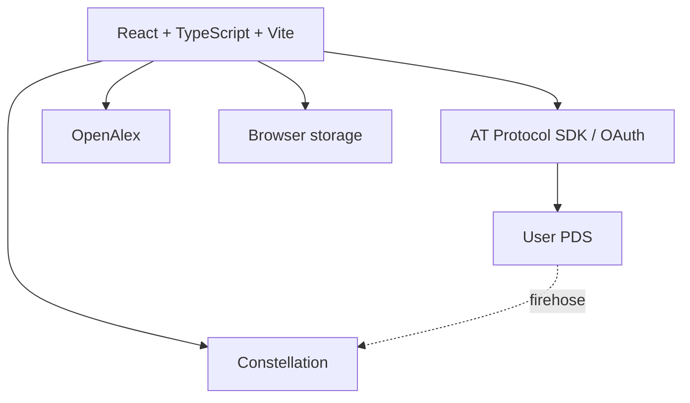

# PaperTrail Architecture

This document outlines our proposed architecture for PaperTrail, starting with the initial MVP and the features we plan to add in later sprints. We aim to keep the application simple and use existing services for authentication, data storage, and paper discovery.

## Initial MVP Setup & Tech Stack

For the initial MVP, we plan to build a frontend-only application without a separate backend server or SQL database. The frontend will communicate directly with AT Protocol services and OpenAlex to handle user accounts, paper-related records, and research paper metadata.

| Technology | Rationale |
| --- | --- |
| React | Reusable components and a mature ecosystem |
| TypeScript | Fewer integration errors when different developers work on separate modules |
| Vite | Simpler frontend setup than a full-stack framework |
| AT Protocol SDK | Handles OAuth and protocol operations without implementing them manually |
| OpenAlex | Provides academic metadata without building a paper database |
| Vercel | Frontend deployment and hosting |
| Constellation | Counts likes across accounts from AT Protocol without backend |

## Application Workflow

The proposed workflow is:

1. A user logs in with AT Protocol OAuth.
2. The React frontend communicates with the user's PDS using authorized requests.
3. Likes and published-paper records are written to the user's repository; published records reference uploaded PDF blobs. Bookmarks remain browser-local and are keyed by DID.
4. Paper searches use OpenAlex.
5. Paper metadata is shown in the frontend.
6. Like count comes from Constellation, which indexes `app.papertrail.like` records from firehose.

## AT Protocol Login and Records

- **OAuth:** `@atproto/oauth-client-browser` handles sign-in with AT Protocol identities, session restoration, and sign-out. React features read the active identity through `useAuth()`. See [Authentication](authentication.md) for local setup, deployment, and the handoff to other features.
- **PDS:** Likes and published papers use public records in users' repositories. A thin repository client provides create/get/list/put/delete for later features.
- **Lexicons:** Published papers have a checked-in custom schema; the collection's formal namespace authority and schema publication remain unconfirmed. See [Publishing](publishing.md) for metadata, PDF storage and retry contracts.

## Paper Metadata

Browse/Search retrieves OpenAlex metadata. Uploaded-paper details retrieve metadata from the publishing account's PDS. Both use common `PaperMetadata` fields, with source-specific identifiers: short OpenAlex work IDs for `/papers/:paperId`, and DID plus record key for `/publications/:repoDid/:rkey`. Community discovery at `/community` uses the relay and public PDS reads from #30; see [Public record discovery](community-discovery.md). Uploaded PDFs use the shared reader through verified Blob inputs (#15), while OpenAlex retains HTTP/HTTPS PDF URLs.

## Data Storage

The proposed design uses two storage mechanisms.

- AT Protocol Repositories: public likes and paper records are stored in the owner's PDS. PDF blobs are stored alongside the repository and referenced by paper records.

- Browser Storage: bookmarks currently use localStorage, isolated by account DID. #34 covers public PDS bookmarks and consent for any migration of local entries.

## PDS Integration

Publishing (#37) stores public paper records and PDF blobs in the owner's PDS. Its reusable repository operations are available to later features; see [Publishing](publishing.md) for the implemented interfaces and PDF retrieval limits.

Shared bookmarks (#34) and Reading Room posts (#31) remain planned integrations. They can build on the repository client while retaining their own record schemas and permission requirements. Existing private bookmarks stay in browser storage and are not migrated automatically.

## Cross-User Record Discovery

Community paper discovery uses the Bluesky relay's repository-by-collection listing, then validates current records from each publisher's resolved PDS. Paper-specific backlinks use Constellation and are verified against current repository records. See [Public record discovery](community-discovery.md) for pagination, partial failures and index limitations.

Reading Room writing remains planned; the existing public record reader can support its later integration.

## Backend Considerations

For the initial MVP, we plan to avoid introducing a separate backend server or SQL database.

This approach helps us:

- Reduce development and deployment complexity.
- Avoid maintaining duplicate user data.
- Use AT Protocol infrastructure for user-owned records.
- Focus on implementing the application's core functionality within the project timeline.

As we add features like Reading Rooms and cross-user record discovery, we may need additional services to find and retrieve public records across different users' PDS repositories. We will first look into existing AT Protocol services before deciding whether a separate backend or indexing service is necessary.

Bluesky paper sharing uses the current account and retains retry recovery across refresh/reauthorization; see [Authentication](authentication.md). Direct messaging remains planned.
