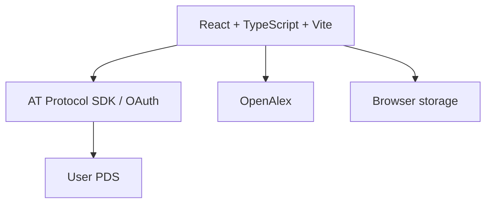

# PaperTrail Architecture

This document outlines the proposed architecture for PaperTrail's initial MVP. The design focuses on keeping the application simple and using existing services for authentication, data storage, and paper discovery.

## Initial MVP Setup & Tech Stack

For the initial MVP, we plan to build a frontend-only application without a separate backend server or SQL database. The frontend will communicate directly with AT Protocol services and OpenAlex to handle user accounts, paper-related records, and research paper metadata.

| Technology | Rationale |
| --- | --- |
| React | Reusable components and a mature ecosystem |
| TypeScript | Fewer integration errors when different developers work on separate modules |
| Vite | Simpler frontend setup than a full-stack framework |
| AT Protocol SDK | Handles OAuth and protocol operations without implementing them manually |
| OpenAlex | Provides academic metadata without building a paper database |
| Vercel | Frontend deployment and hosting |

## Application Workflow

The proposed workflow is:

1. A user logs in with AT Protocol OAuth.
2. The React frontend communicates with the user's PDS using authorized requests.
3. Saved-paper records are written to the user's repository.
4. Paper searches use OpenAlex.
5. Paper metadata is shown in the frontend.

## AT Protocol Login and Records

- **OAuth:** `@atproto/oauth-client-browser` handles sign-in with AT Protocol identities, session restoration, and sign-out. React features read the active identity through `useAuth()`. See [Authentication](authentication.md) for local setup, deployment, and the handoff to other features.
- **PDS:** Public PaperTrail records would be stored in users' AT Protocol repositories.
- **Lexicons:** PaperTrail would define its own record schemas for app-specific data.

## Paper Metadata

PaperTrail will use OpenAlex to retrieve research paper information. This allows us to support paper discovery without building and maintaining our own database of research paper metadata.

## Data Storage

The proposed design uses two storage mechanisms.

- AT Protocol Repositories: public PaperTrail records will be stored in users' PDS repositories rather than in a centralized application database.

- Browser Storage: for information users do not want to share publicly, we can use browser-side storage such as localStorage or IndexedDB.

## Backend Considerations

For the initial MVP, we plan to avoid introducing a separate backend server or SQL database.

This approach helps us:

- Reduce development and deployment complexity.
- Avoid maintaining duplicate user data.
- Use AT Protocol infrastructure for user-owned records.
- Focus on implementing the application's core functionality within the project timeline.

