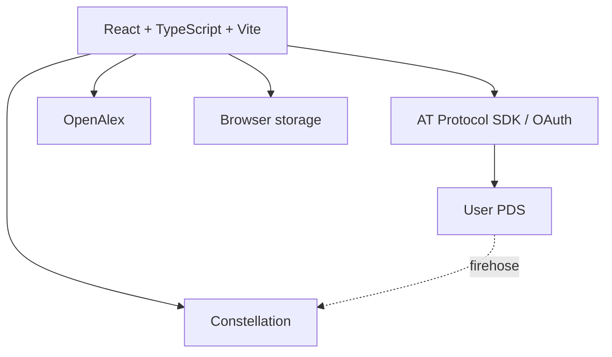

# PaperTrail Architecture

This document outlines our proposed architecture for PaperTrail, starting with the initial MVP and the features we plan to add in later sprints. We aim to keep the application simple and use existing services for authentication, data storage, and paper discovery.

## Initial MVP Setup & Tech Stack

For the initial MVP, we plan to build a frontend-only application without a separate backend server or SQL database. The frontend will communicate directly with AT Protocol services and OpenAlex to handle user accounts, paper-related records, and research paper metadata.

| Technology | Rationale |
| --- | --- |
| React | Reusable components and a mature ecosystem |
| TypeScript | Fewer integration errors when different developers work on separate modules |
| Vite | Simpler frontend setup than a full-stack framework |
| AT Protocol SDK | Handles OAuth and protocol operations without implementing them manually |
| OpenAlex | Provides academic metadata without building a paper database |
| Vercel | Frontend deployment and hosting |
| Constellation | Counts likes across accounts from AT Protocol without backend |

## Application Workflow

The proposed workflow is:

1. A user logs in with AT Protocol OAuth.
2. The React frontend communicates with the user's PDS using authorized requests.
3. Public PaperTrail records can be stored in the user's PDS as repository integration is implemented.
4. Paper searches use OpenAlex.
5. Paper metadata is shown in the frontend.
6. Like count comes from Constellation, which indexes `app.papertrail.like` records from firehose.

## AT Protocol Login and Records

- **OAuth:** `@atproto/oauth-client-browser` handles sign-in with AT Protocol identities, session restoration, and sign-out. React features read the active identity through `useAuth()`. See [Authentication](authentication.md) for local setup, deployment, and the handoff to other features.
- **PDS:** Public PaperTrail records would be stored in users' AT Protocol repositories.
- **Lexicons:** PaperTrail would define its own record schemas for app-specific data.

## Paper Metadata

PaperTrail will use OpenAlex to retrieve research paper information. This allows us to support paper discovery without building and maintaining our own database of research paper metadata.

## Data Storage

The proposed design uses two storage mechanisms.

- AT Protocol Repositories: public PaperTrail records will be stored in users' PDS repositories rather than in a centralized application database.

- Browser Storage: for information users do not want to share publicly, we can use browser-side storage such as localStorage or IndexedDB.

## Planned PDS Integration

We plan to use AT Protocol repositories for public PaperTrail records, including published papers, shared bookmarks, and Reading Room posts. Each type of record will follow a custom Lexicon so we can store and retrieve data in a consistent format.

Our initial implementation will focus on publishing and retrieving paper records. We also plan to set up reusable repository operations that other features can use, instead of implementing similar PDS logic separately for each feature.

Private information can remain in browser storage, while public records can be stored in the user's PDS.

## Cross-User Record Discovery

Since each user's public records are stored in their own PDS, we also need a way to find records from different users.

This is especially important for Reading Rooms. When users open a paper's Reading Room, they should be able to see posts and replies from other researchers discussing the same paper.

We plan to investigate how to retrieve these records across users and whether an indexing service is needed. The exact approach has not been decided yet.

## Backend Considerations

For the initial MVP, we plan to avoid introducing a separate backend server or SQL database.

This approach helps us:

- Reduce development and deployment complexity.
- Avoid maintaining duplicate user data.
- Use AT Protocol infrastructure for user-owned records.
- Focus on implementing the application's core functionality within the project timeline.

As we add features like Reading Rooms and cross-user record discovery, we may need additional services to find and retrieve public records across different users' PDS repositories. We will first look into existing AT Protocol services before deciding whether a separate backend or indexing service is necessary.

For other planned features, such as sharing papers to Bluesky and direct messaging, we plan to investigate the available APIs and how they can work with our existing authentication setup.
